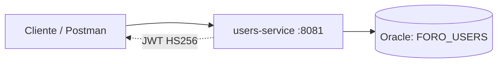

# Microservicio de Usuarios (users-service)

Backend academico para Full Stack III: **microservicio de usuarios con Spring Boot**, sin frontend y sin pagos. Java 17, Spring Boot 3.5.7, Maven, Spring Data JPA, Spring Security y Oracle JDBC. Organizacion por capas conforme a la guia de aprendizaje.

## Alcance

| Microservicio | Puerto | Responsabilidad |
| --- | --- | --- |
| users-service | 8081 | Registro, login y CRUD de usuarios; asignacion de roles |

`common` es una biblioteca compartida de seguridad y manejo global de errores.

| Actor | Privilegios |
| --- | --- |
| Visitante | Registrar cuenta e iniciar sesion |
| USER | Lo anterior; consultar, actualizar y eliminar su propia cuenta |
| ADMIN | Lo anterior; listar/gestionar cualquier usuario y asignar roles |

El registro publico solo crea USER. ADMIN se crea con el perfil demo o por asignacion de otro ADMIN. Los DTO no admiten propiedades desconocidas: enviar `role` en registro devuelve 400.

## Arquitectura



El servicio utiliza su propio esquema (`FORO_USERS`), credenciales y tablas en Oracle.

```text
common/                  Seguridad JWT, CORS y manejo global de errores
users-service/
  src/main/java/cl/duoc/foro/users/
    controller/          Endpoints REST
    dto/                 Entradas validadas y respuestas sin contrasenas
    entity/              Entidades JPA
    repository/          Acceso a datos
    service/             Reglas de negocio
    config/              Datos de demostracion
database/                DDL Oracle para creacion de usuario y esquema
.github/workflows/       Compilacion y pruebas en GitHub Actions
```

## 1. Compilar y probar

Desde la carpeta del proyecto, con JDK 17 y Maven 3.9 o superior:

```powershell
mvn clean package -DskipTests
```

O para ejecutar tambien las pruebas automaticas:

```powershell
mvn verify
```

Genera el JAR ejecutable en `users-service/target/users-service-1.0.0-SNAPSHOT.jar`. Las pruebas usan **H2 en modo Oracle solo en test** y no requieren credenciales. Cubren JWT, CRUD, permisos, validaciones y datos iniciales. **H2 no demuestra compatibilidad completa con Oracle**: probar ademas los endpoints con el servicio conectado a Oracle.

## 2. Preparar Oracle

Se requiere Oracle 19c o superior (incluye Oracle XE/Free y Autonomous Database). No usar una base productiva para esta evaluacion.

1. Crear la cuenta `FORO_USERS`. En Oracle local, ejecutar como administrador `database/00-create-users-local.sql` con SQL*Plus, SQLcl o SQL Developer (Run Script/F5). Requiere el tablespace `USERS`.
2. En Autonomous Database, crear la cuenta `FORO_USERS` con permisos `CREATE SESSION`, `CREATE TABLE`, `CREATE SEQUENCE` y cuota en el tablespace `DATA`. El script de creacion local **no se aplica sin adaptar el tablespace**.
3. Conectar como `FORO_USERS` y ejecutar `database/01-users-schema.sql`.

El script crea la tabla y secuencia necesarias; ejecutarlo **una sola vez sobre el esquema nuevo**. No contiene DROP, TRUNCATE ni borrados de datos. Hibernate usa `ddl-auto: validate`: comprueba el esquema, no lo crea ni lo elimina.

| Esquema | Tabla | Registros iniciales con demo |
| --- | --- | --- |
| FORO_USERS | APP_USERS | 3 |

Los roles son un enum/columna de `APP_USERS`, no una tabla adicional.

### Conexion local

El servicio cuenta con valores por defecto en `application.yml` (`jdbc:oracle:thin:@localhost:1521/XEPDB1`, usuario `FORO_USERS`, clave `user2026` y `DEMO_PASSWORD` con valor `Demo1234`), que pueden sobrescribirse mediante variables de entorno en la terminal:

```powershell
$env:JWT_SECRET = '<clave-aleatoria-de-al-menos-32-bytes>'
$env:DEMO_PASSWORD = '<clave-demo-de-8-a-72-caracteres-ASCII-sin-espacios>'
$env:USERS_DB_URL = 'jdbc:oracle:thin:@localhost:1521/XEPDB1'
$env:USERS_DB_USERNAME = 'FORO_USERS'
$env:USERS_DB_PASSWORD = '<clave-de-FORO_USERS>'
```

Para introducir una clave sin mostrarla ni escribirla en el historial de PowerShell 5.1:

```powershell
$env:USERS_DB_PASSWORD = [System.Net.NetworkCredential]::new('', (Read-Host 'Clave Oracle de usuarios' -AsSecureString)).Password
```

No publicar contrasenas, tokens ni Wallet en Git, capturas o videos.

### Conexion Oracle Cloud con Wallet

Descargar y descomprimir el Wallet **localmente**, por ejemplo en una carpeta `Wallet_Foro` dentro de la raiz del proyecto. Esta carpeta y sus certificados estan ignorados por Git. No modificar ni compartir sus secretos.

Reemplazar la URL local por el alias exacto que aparece en `tnsnames.ora` y una ruta absoluta con `/`. Ejemplo de formato, ajustando alias y ruta:

```powershell
$env:USERS_DB_URL = 'jdbc:oracle:thin:@miinstancia_high?TNS_ADMIN=C:/ruta/UserServiceForo/Wallet_Foro'
```

Se incluyen `ojdbc11`, `oraclepki`, `osdt_core` y `osdt_cert` para Wallet. La accesibilidad de red, las credenciales, el alias TNS y la configuracion TLS del Wallet deben corresponder a tu instancia.

## 3. Arrancar y cargar datos

Con el esquema ya creado y las variables configuradas, iniciar el microservicio de usuarios:

```powershell
java -jar users-service/target/users-service-1.0.0-SNAPSHOT.jar --spring.profiles.active=demo
```

El puerto por defecto es `8081` (configurable con `USERS_PORT`).

El perfil `demo` crea `admin@foro.test` (ADMIN), `ana@foro.test` y `luis@foro.test` (USER), todos con la contrasena definida en `DEMO_PASSWORD` (por defecto `Demo1234`), almacenada con BCrypt. La carga de usuarios se omite si `APP_USERS` no esta vacia; no rellena esquemas parcialmente poblados ni restablece claves al reiniciar.

Para arranques posteriores sin carga inicial, omitir `--spring.profiles.active=demo`:

```powershell
java -jar users-service/target/users-service-1.0.0-SNAPSHOT.jar
```

## Endpoints

Todos los cuerpos son JSON. Usar `Content-Type: application/json` al enviar cuerpos y `Authorization: Bearer <accessToken>` cuando corresponda. Fechas de creacion en UTC.

| Metodo | Ruta | Acceso |
| --- | --- | --- |
| POST | :8081/api/auth/register | Publico; displayName, email, password |
| POST | :8081/api/auth/login | Publico; email, password; devuelve accessToken |
| GET | :8081/api/users | ADMIN; paginado (`page`, `size`) |
| GET | :8081/api/users/me | Autenticado |
| GET | :8081/api/users/{id} | Propietario o ADMIN |
| PUT | :8081/api/users/{id} | Propietario o ADMIN; displayName, email, password opcional |
| PUT | :8081/api/users/{id}/role | ADMIN; role: USER o ADMIN |
| DELETE | :8081/api/users/{id} | Propietario o ADMIN |

Paginacion en `GET /api/users`: `page` desde 0, `size` de 1 a 100 (20 por defecto).

Respuestas:
- `200` consulta, actualizacion o login
- `201` creacion con cabecera `Location`
- `204` eliminacion sin cuerpo
- `400` validacion o JSON invalido
- `401` falta de autenticacion o credenciales invalidas
- `403` falta de permisos
- `404` recurso inexistente
- `409` email duplicado

Errores esperados en formato `application/problem+json`, con `errors` por campo para fallos de validacion.

## Seguridad y limites

Contrasenas BCrypt; ningun DTO expone el hash. JWT firmado con HS256, emisor validado y duracion de 15 minutos. Si se integra con otros microservicios del foro, deben compartir la misma clave `JWT_SECRET` de al menos 32 bytes. CORS permite por defecto `http://localhost:3000`, configurable con `SECURITY_CORS_ORIGINS` (lista separada por comas). CSRF desactivado porque la API es stateless y usa Bearer, no cookies de sesion.

Los JWT son stateless: **eliminar una cuenta, cambiar su rol o su clave no revoca tokens ya emitidos**; conservan sus permisos hasta expirar (con la tolerancia de reloj del validador). El perfil demo es exclusivamente academico.

